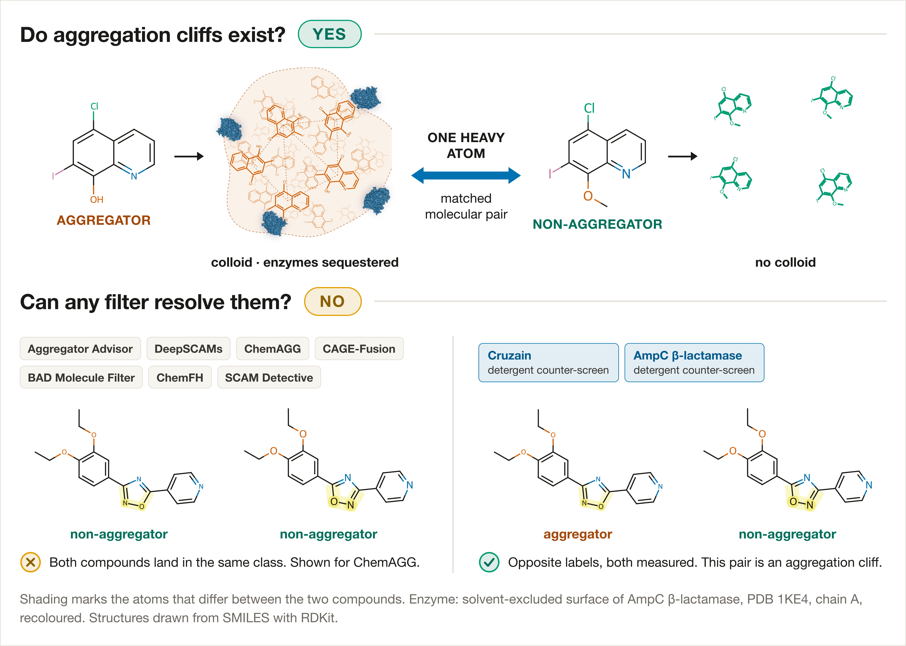

# Aggregation Cliffs

Data and code for:

**Aggregation Cliffs in Screening Benchmarks: A Matched Molecular Pair Census and a Pair-Level Evaluation of Published Filters**
Abdallah Abou Hajal, College of Pharmacy and AAU Health and Biomedical Research Center, Al Ain University, Abu Dhabi, UAE.

An aggregation cliff is a matched molecular pair whose two members carry opposite colloidal aggregation labels. This repository holds the census of 3,365 such pairs mined from two detergent counter-screens, every filter's verdict on each member, the structures nominated for light scattering, and the code that produced all of it.

## The short version

Near-identical compounds carry opposite aggregation labels far more often than the benchmarks admit. Seven published filters and a plain clogP cutoff were asked about each member of a pair separately. They gave both members the same class in 90.6% to 95.6% of pairs, and none beat the clogP cutoff under an exact paired test.

## Files

### data/

| file | rows | what it is |
|---|---|---|
| `census_all.csv` | 3,365 | The census: every pair from both screens. |
| `census_ampc.csv` | 1,706 | AmpC beta-lactamase pairs only. |
| `census_cruzain.csv` | 1,659 | Cruzain pairs only. |
| `filter_verdicts_500_pairs.csv` | 500 | Each filter's call on each member of the evaluated sample. Read the note below. |
| `representation_resolvability.csv` | 12 | Pairs rendered identical by each of twelve fingerprints. An upper bound on any model using only that representation. |
| `chemfh_per_compound.csv` | 5,928 | ChemFH's seven probabilities and ten rule counts per compound, so pairs can be re-formed at a different threshold. |
| `candidate_structures_for_measurement.csv` | 942 | Generated analogues nominated for dynamic light scattering. These carry no experimental label. |

`aggregation_cliffs_data.zip` holds the same seven CSVs in one download.

Census columns: `kind`, `tanimoto`, `agg_smiles`, `non_smiles`, `agg_ik`, `non_ik`, `d_clogp`, `d_mw`, `d_tpsa`, `d_heavy`, `agg_heavy`, `non_heavy`, `agg_clogp`, `non_clogp`, `dataset`. `agg_` is the member labelled aggregator, `non_` its partner, `_ik` is the InChIKey, and `d_` differences are aggregator minus non-aggregator.

### src/

The analysis scripts. `mine_cliffs.py` builds the census, `representation_sweep_molvs.py` produces the fingerprint table, `fig_census_pipeline_v2.py` draws Figure S1. Python 3.11.16, RDKit 2026.03.1, scikit-learn 1.9.0, SciPy 1.17.1, pandas 2.3.3, scikit-fingerprints 2.1.0. Seed 20260928 everywhere.

Four scripts read the prepared cruzain set, which is not redistributed here because it belongs to the companion work. Point `CLIFFS_SOURCE_DATA` at it, or rebuild it from PubChem AID 1476 and AID 1478 using the standardisation recipe in the Methods.

## Two things to read before reusing this

**The negative label is not a measurement.** In both screens a compound is recorded as a non-aggregator when no dose-response curve can be fitted with or without detergent. That records an absence of activity against one enzyme. Colloid formation was never tested. Every rate here counts label disagreement rather than measured physical discontinuity, and the distinction matters for anything built on these files.

**The census is matched in lipophilicity and mass.** Pairs were kept only when they differ by less than 0.5 Crippen clogP units and less than 30 Da. Resolution rates measured on this census are not interchangeable with rates on an unrestricted pair population.

## One file is on an earlier preparation

The AmpC set was re-standardised with MolVS to match cruzain after the filter runs had been done. The census, the fingerprint table and everything else here use the harmonized preparation. `filter_verdicts_500_pairs.csv` could not be regenerated, because three of the web services were unreachable and the vendored models are not redistributable. It carries an `in_harmonized_census` column instead: 478 of the 500 pairs are in the harmonized census, 22 are not. Filter to `yes` if you need one preparation throughout.

## Filters evaluated

None of these is redistributed here. Get each from its own source.

| filter | source |
|---|---|
| BAD Molecule Filter | https://github.com/AbdallahHajal/BAD-Molecule-Filter (GPL-3.0) |
| ChemAGG | https://admet.scbdd.com |
| Aggregator Advisor | https://advisor.docking.org |
| SCAM Detective | published release, 2019 scikit-learn required to load |
| DeepSCAMs | authors' repository, refits at run time |
| CAGE-Fusion | published release |
| ChemFH | Ersilia Model Hub, `eos7ye0` |

The BAD Molecule Filter is the author's own work. That conflict of interest is declared in the paper.

## Licence

Code under MIT, data under CC-BY-4.0. See `LICENSE` and `LICENSE-DATA`.

## Citation

See `CITATION.cff`. Cite the paper, and cite the archived release by its DOI if you use the data.
